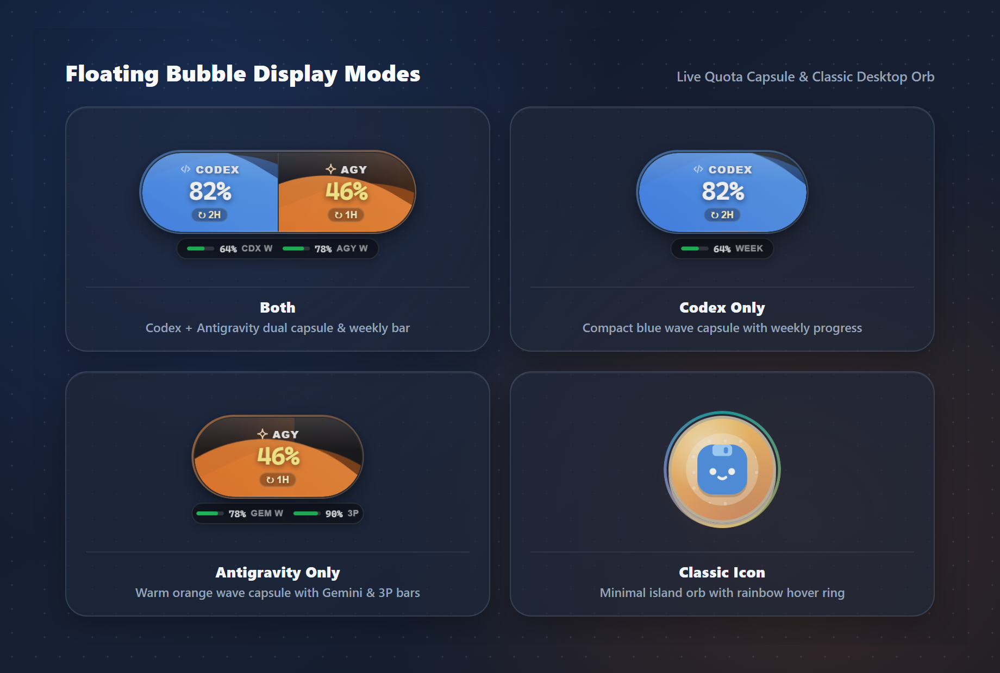
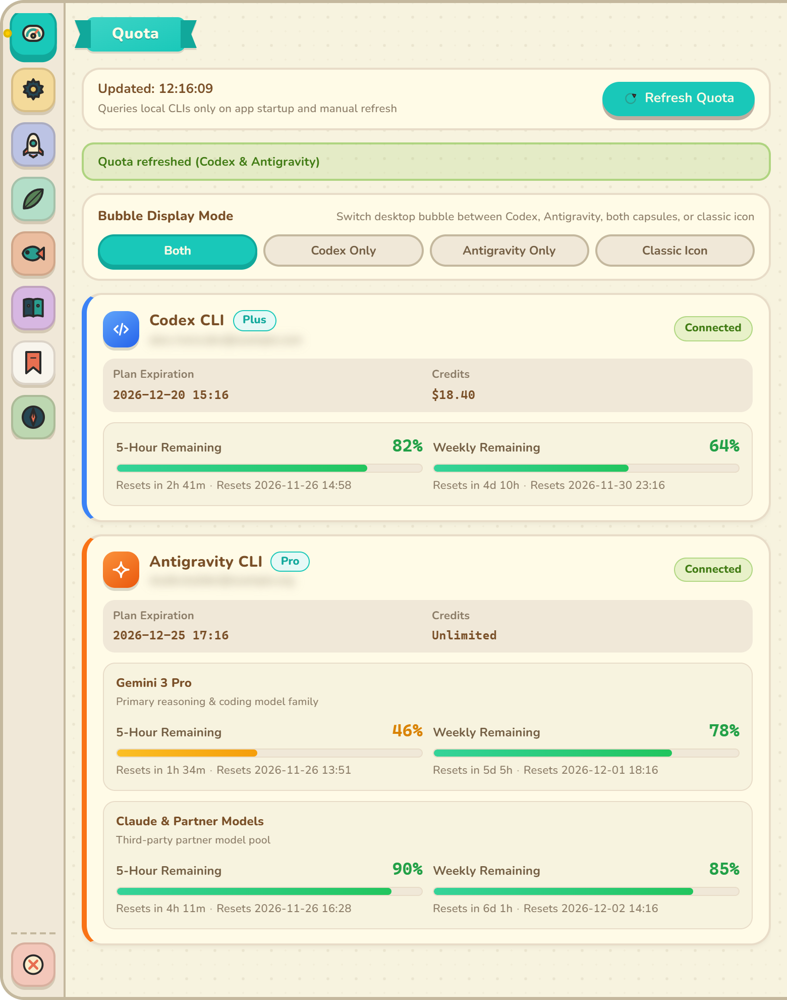

# GodotMemory

<p align="center">
  
</p>

**GodotMemory** is a lightweight desktop launcher and workspace companion for Godot Engine developers—combining an always-on-top **AI CLI Quota Floating Bubble** (Codex CLI & Antigravity CLI) with quick-access panels for engines, projects, assets, external tools, development diaries, and detachable desktop sticky notes.

Built with [Tauri 2](https://v2.tauri.app), React, TypeScript, and Rust.

## Overview

GodotMemory lives on your desktop as a draggable, edge-snapping floating bubble that renders live 5-hour and weekly quota levels as animated water-tank energy capsules (or a classic circular icon). Click the bubble to expand the main workspace panel, or right-click the system tray icon to show/hide, refresh CLI quotas on demand, or exit.





## Modules & Documentation

Explore each module in detail:

| Module | Description | Guide |
| --- | --- | --- |
| **CLI Plan Quota & Floating Bubble** | Live 5-hour & weekly quota tracking for Codex CLI (`codex`) and Antigravity CLI (`agy`), plus the 4-mode edge-snapping energy capsule bubble | [docs/quota-and-bubble.md](docs/quota-and-bubble.md) |
| **Engine Manager** | Manage local Godot Engine installations, versions, default engines, consoles, and encryption keys | [docs/engine-manager.md](docs/engine-manager.md) |
| **Project Manager** | Browse, scan, tag, star, and launch Godot projects with linked engine versions | [docs/project-manager.md](docs/project-manager.md) |
| **Asset Browser** | Organize, search, tag, preview screenshots, and open local Godot assets | [docs/asset-browser.md](docs/asset-browser.md) |
| **Toolbox** | Catalog and launch external utilities with automatic EXE icon extraction, tags, and screenshot view | [docs/toolbox.md](docs/toolbox.md) |
| **Diary** | Multi-notebook daily development journal with month-grouped date chips, auto-save, and collapsible sidebar | [docs/diary.md](docs/diary.md) |
| **Sticky Notes** | Detachable frameless desktop sticky notes with 5 pastel palettes and screen-edge peek tabs | [docs/sticky-notes.md](docs/sticky-notes.md) |
| **Settings** | Theme, language, auto-start, floating bubble preferences, screenshot folder, legacy DB import, and fast tag management | [docs/settings.md](docs/settings.md) |

## Design Language

The interface is styled in the **Animal Island** visual language—cream parchment surfaces, warm earth-brown text, mint-teal accents, thick 2px borders, 50px pill buttons and inputs, and pixel-stacked 3D shadows on primary buttons. Modals use an organic SVG blob silhouette instead of a plain rounded rectangle, and the panel title is a swallow-tail ribbon. Rounded typography uses [Nunito](https://fonts.google.com/specimen/Nunito) (Latin) and [Noto Sans SC](https://fonts.google.com/noto/specimen/Noto+Sans+SC) (Simplified Chinese), loaded from Google Fonts with system fallbacks when offline.

The visual style is derived from [animal-island-ui](https://github.com/guokaigdg/animal-island-ui) by guokaigdg, used under [CC BY-NC 4.0](https://creativecommons.org/licenses/by-nc/4.0/). Its components are not a runtime dependency: the design tokens live in `src/styles/index.css`, and icon artwork is vendored into `src/components/island-icons.tsx` (derived from `src/components/Icon/src/*Icon.tsx`, same 48×48 viewBox and palette). The application and classic bubble icons are generated from `public/icon.svg` via `npx tauri icon`. The floating quota capsule design is inspired by [AntigravityQuotaWatcherDesktop](https://github.com/wusimpl/AntigravityQuotaWatcherDesktop).

## Development

### Prerequisites

- [Node.js](https://nodejs.org) 20+
- [Rust](https://rustup.rs) 1.77+
- [Tauri 2 system dependencies](https://v2.tauri.app/start/prerequisites/)

### Setup

```bash
npm install
npm run tauri dev
```

### Build

```bash
npm run tauri build
```

Output bundles are written to `src-tauri/target/release/bundle/`.

## License

[MIT](LICENSE)
