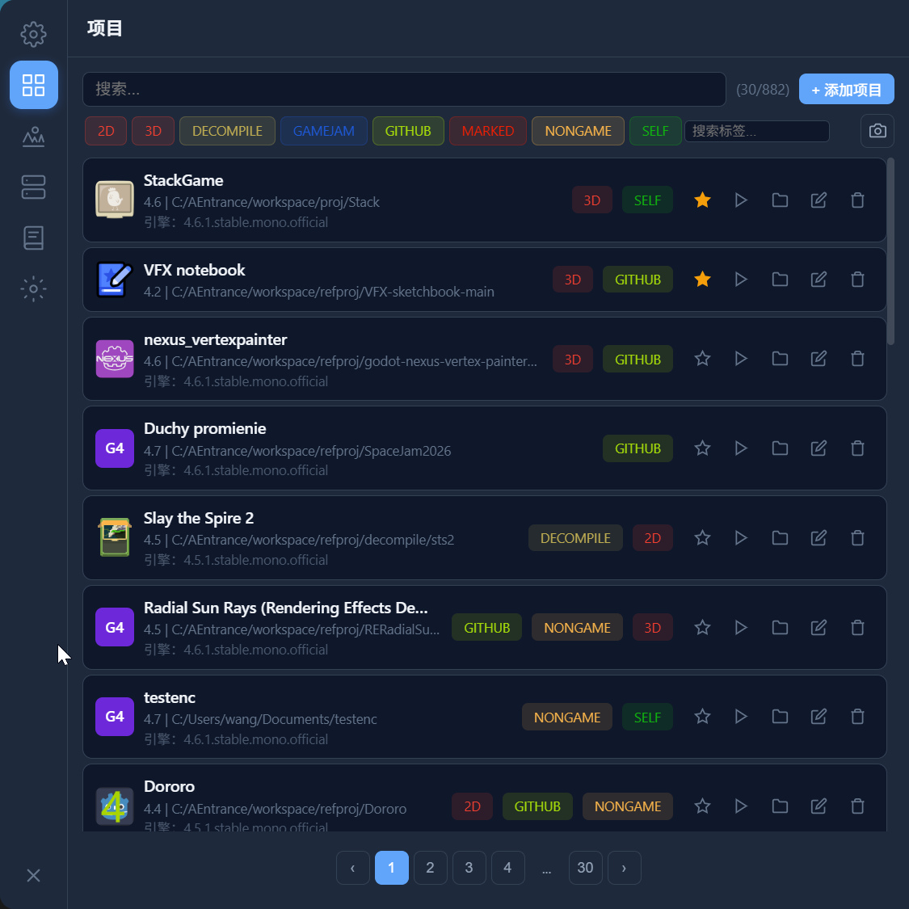
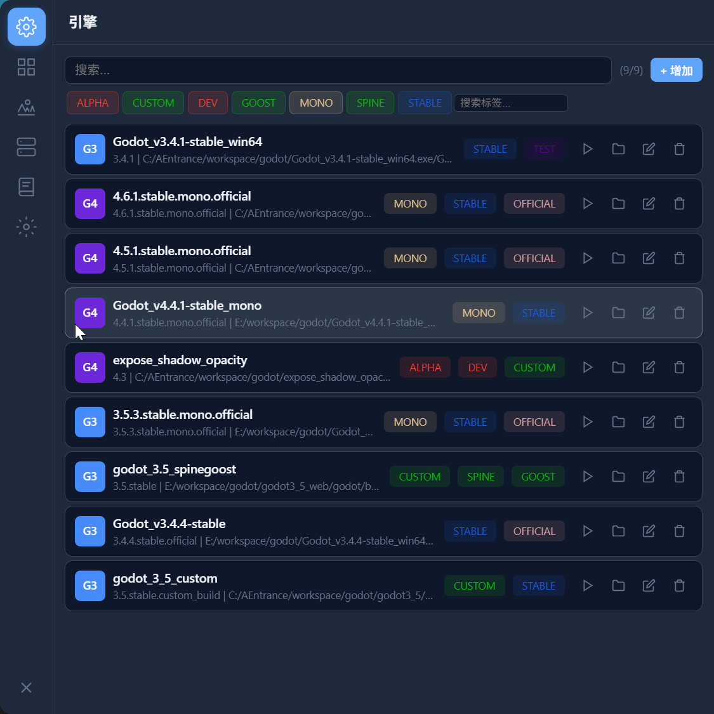
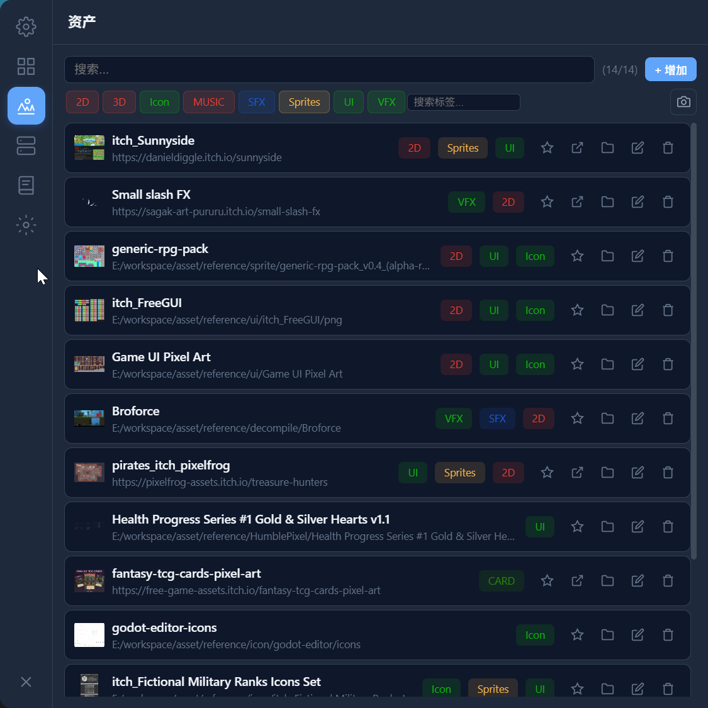
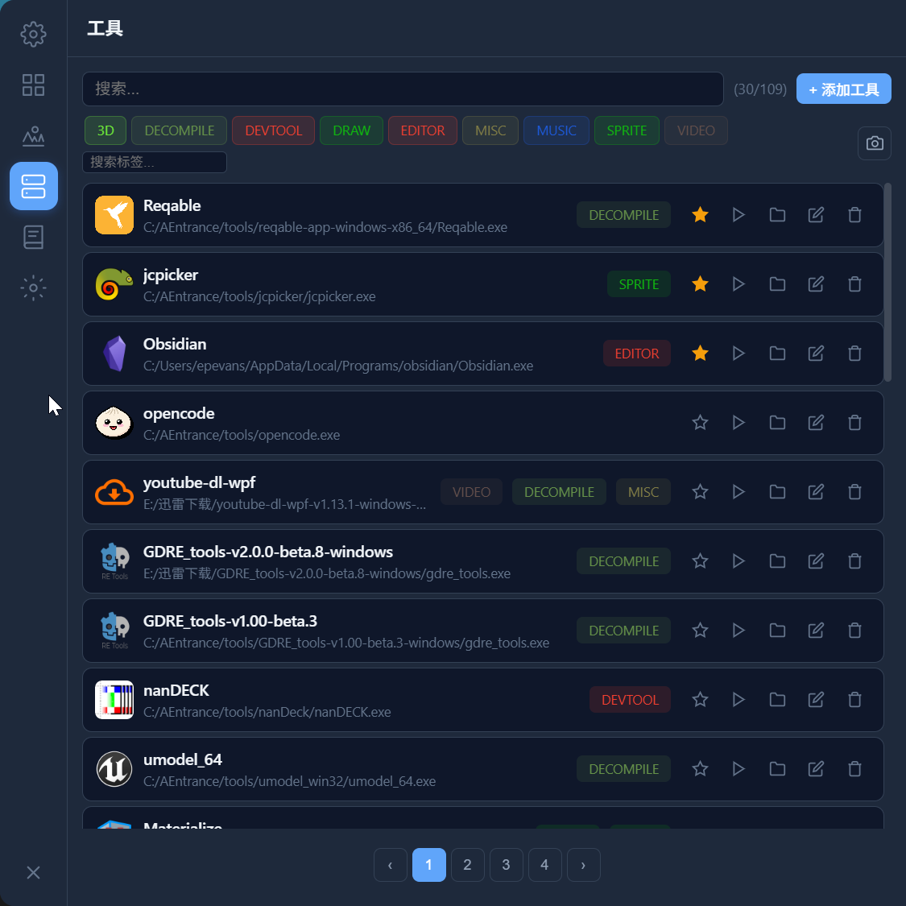
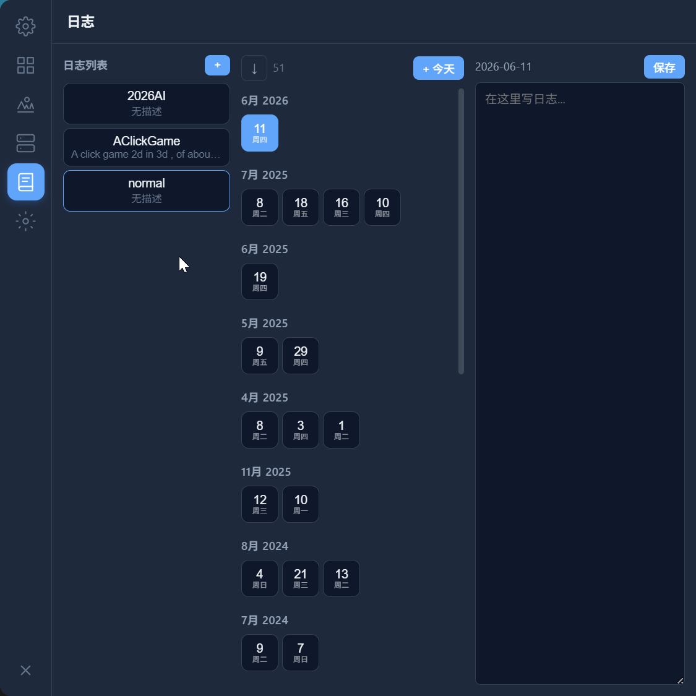
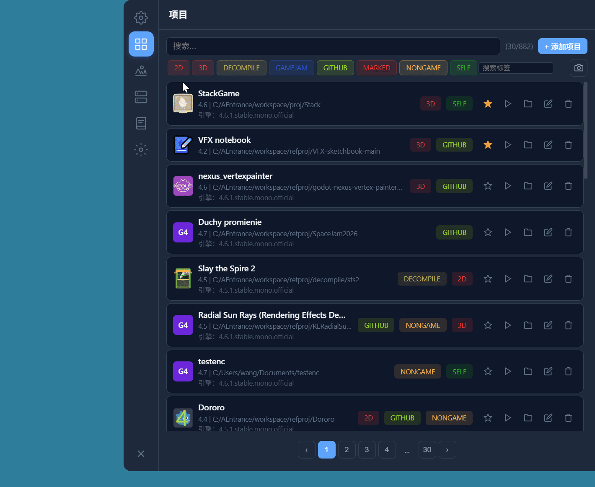
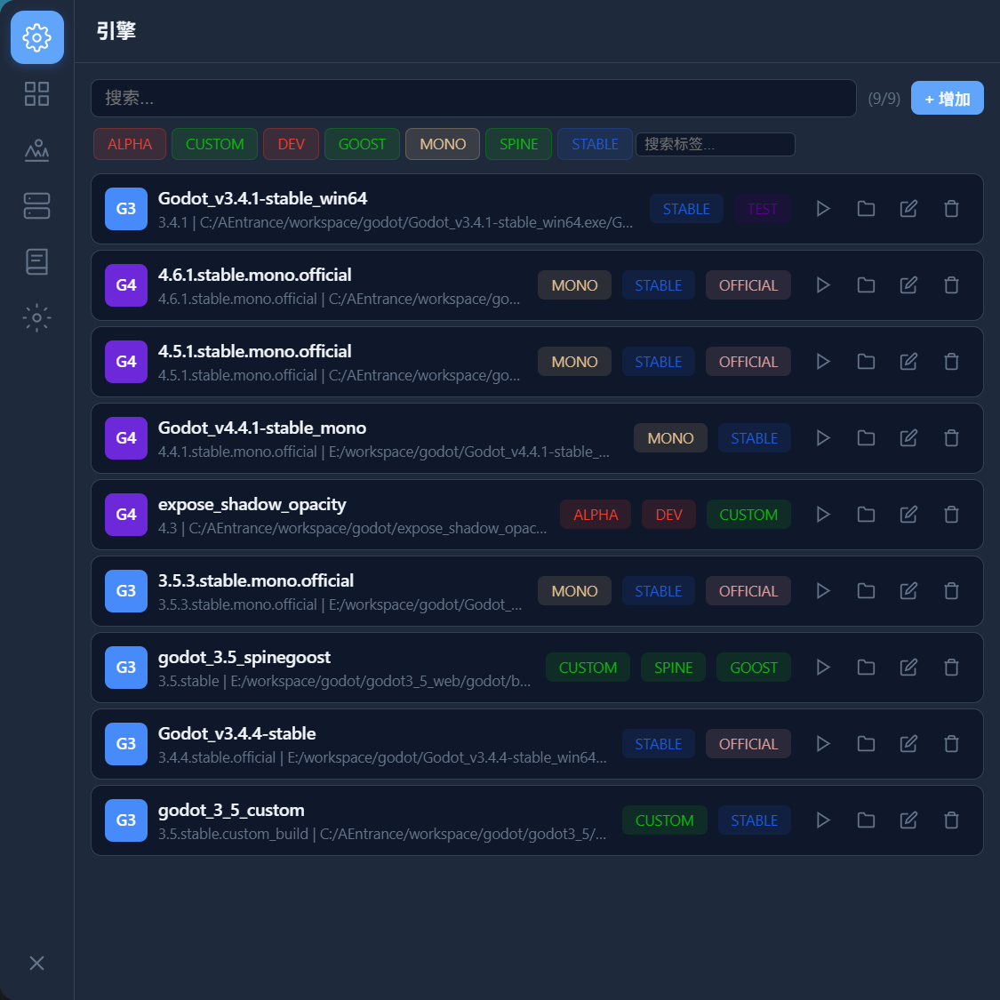

# GodotMemory

<p align="center">
  
</p>

Godot Engine / Tool / Asset management tool — a floating bubble launcher that provides quick access to engine monitors, project management, asset browsing, tools, and diary notes.

Built with [Tauri 2](https://v2.tauri.app), React, TypeScript, and Rust.

## Screenshots









## Features

- **Engine Monitor** — real-time memory/resource usage for Godot Editor
- **Project Manager** — browse and launch Godot projects
- **Asset Browser** — browse, search, and open assets
- **Toolbox** — quick access to common Godot tools
- **Diary** — note-taking panel for development ideas
- **Floating Bubble** — click to expand, drag to move, always-on-top

## Design language

The interface is skinned in the **Animal Island** visual language — cream parchment
surfaces, warm earth-brown text, mint-teal accents, thick 2px borders, 50px pill
buttons and inputs, and pixel-stacked 3D shadows on primary buttons. Modals use an
organic SVG blob silhouette instead of a plain rounded rectangle, and the panel
title is a swallow-tail ribbon. Rounded type is [Nunito](https://fonts.google.com/specimen/Nunito)
(Latin) + [Noto Sans SC](https://fonts.google.com/noto/specimen/Noto+Sans+SC) (中文),
loaded from Google Fonts, with system fallbacks when offline.

Structure and behaviour are unchanged — only the presentation layer (CSS token set,
component classes and markup hooks) was replaced.

The style is derived from [animal-island-ui](https://github.com/guokaigdg/animal-island-ui)
by guokaigdg, used under [CC BY-NC 4.0](https://creativecommons.org/licenses/by-nc/4.0/)
(design tokens / visual rules only — the library is not a runtime dependency).

## Development

### Prerequisites

- [Node.js](https://nodejs.org) 20+
- [Rust](https://rustup.rs) 1.77+
- [Tauri 2 system dependencies](https://v2.tauri.app/start/prerequisites/)

### Setup

```bash
npm install
npm run tauri dev
```

### Build

```bash
npm run tauri build
```

Output bundles will be in `src-tauri/target/release/bundle/`.

## License

[MIT](LICENSE)
