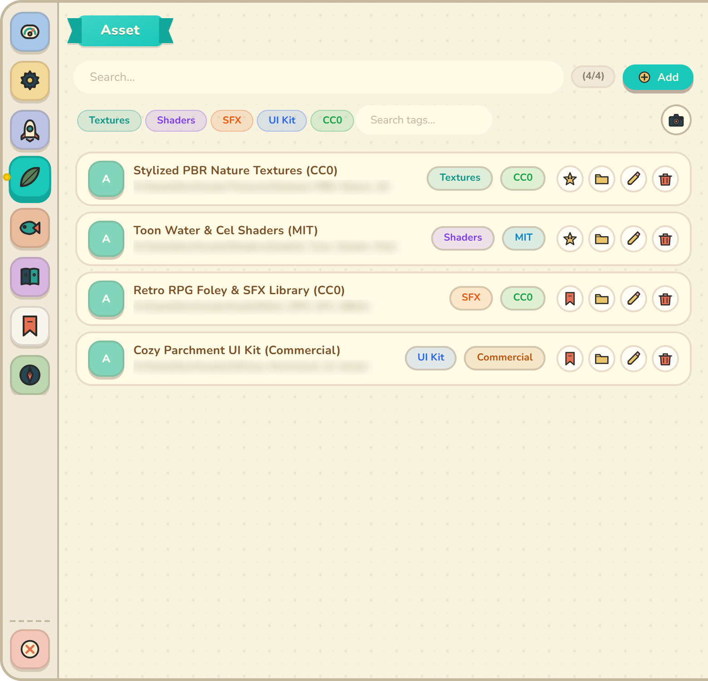

[← Back to README](../README.md)

# Asset Browser

> *Note: Local filesystem paths in screenshots may be blurred for privacy.*

## Overview

The **Asset Browser** helps you catalog and visually browse all of your local game development assets—sprites, tilesets, 3D models, UI kits, fonts, audio packs, shaders, and reference libraries. Every asset entry stores its local folder path alongside optional source URLs, copyright/license notes, tags, and cached preview screenshots so you can find the right pack in seconds.

---

## Key Features

- **Unified Asset Metadata**: Track **Name**, local **Directory**, reference **Link** (e.g., store page, repository, or documentation URL), **Copyright / License** information, and a freeform **Description**.
- **Visual Screenshot Browsing**: Attach multiple preview images (`png`, `jpg`, `jpeg`, `gif`, `bmp`, `webp`) and toggle the list between **Text View** and **Screenshot View** with lazy-loaded thumbnails and hover-to-zoom previews.
- **Automatic Row Thumbnail**: The first attached screenshot automatically becomes the asset's row icon (assets without images display a mint-green `A` badge).
- **Quick Folder & Browser Access**: Open the asset's local directory in your file manager or launch its external reference link directly in your default web browser.
- **Star Favorites**: Pin go-to asset packs to the top of the list.
- **License-Aware Search & Tag Filtering**: Keyword search matches across **Name**, **Description**, **Link**, and **Copyright**, making it easy to search by license (such as `CC0` or `MIT`) in addition to combining multi-tag filters.

---

## How to Use

### Adding an Asset

1. Open the main panel and switch to the **Asset** tab (leaf icon) in the left sidebar.
2. Click **+ Add** in the top-right toolbar.
3. Fill in the asset details:
   - **Name** *(required)*: A clear label for the asset pack (e.g., `Pixel Forest Tileset`).
   - **Directory** *(required)*: Path to the local folder containing the asset files (e.g., `C:/GameAssets/PixelForest` or `/path/to/assets/pixel-forest`).
   - **Link** *(optional)*: Source URL such as a store page, creator website, or repository (e.g., `https://example.com/pixel-forest-pack`).
   - **Copyright** *(optional)*: License or attribution terms (e.g., `CC0`, `CC-BY 4.0 - Credit Author`, `Commercial License`).
   - **Description** *(optional)*: Notes on resolution, file formats, palette, or usage.
4. Assign **Tags** by clicking fast-tag chips (`+tag`) or typing in the tag input field (supports autocomplete and creates new tags automatically).
5. Click **Add screenshot** to attach one or more preview images. Images are copied into GodotMemory's local cache; remove any image using the `×` button on its thumbnail.
6. Click **Save**.

### Browsing & Opening Assets

Each asset row offers up to five quick actions:

- **Star / Unstar** (Star / Bookmark icon): Pins or unpins the asset at the top of the list.
- **Open Link** (Globe icon, shown only when a **Link** is saved): Opens the saved URL in your system's default web browser.
- **Open Folder** (Folder icon): Opens the local asset directory in your OS file explorer.
- **Edit** (Pencil icon): Modifies asset details, tags, or preview screenshots.
- **Delete** (Trash icon): Soft-deletes the asset record from GodotMemory (your asset files on disk are untouched).

### Switching Between Text View and Screenshot View

1. Click the **Camera** button on the right side of the filter toolbar (`Show Screenshots` / `Show Text`).
2. **Text View**: Displays the asset thumbnail, **Name**, **Link** (or **Directory** if no link is set), and up to 3 tag chips.
3. **Screenshot View**: Displays a horizontal strip of all attached preview screenshots per asset. Hover over any thumbnail to inspect it in a floating zoomed overlay.

### Searching & Filtering

- **Keyword Search**: Type in the search bar to match **Name**, **Description**, **Link**, or **Copyright**. For example, search `CC0` to find public-domain packs or `itch.io` to find assets from a specific storefront.
- **Tag Filters**: Click fast-tag chips to toggle tag filters, or type into `Search tags...` to pick any asset tag from the autocomplete dropdown. Click **x clear** to clear active tag filters.
- **Pagination**: Displays **30 assets per page**, with starred items sorted first.

---

## Tips & Notes

- **Put Your Best Preview First**: Because the first image in an asset's screenshot list is also used as its row icon in both Text View and Screenshot View, add your clearest cover image or sprite sheet preview first.
- **Track Attribution Early**: Recording license details in the **Copyright** field as soon as you download an asset makes end-of-project credits and compliance checks effortless later via keyword search.
- **Organize with Fast Tags**: In **Setting → Fast Tags Management**, promote common asset types (`2D`, `3D`, `UI`, `Audio`, `SFX`, `Shaders`, `Fonts`, `CC0`) to fast tags for instant filtering.
- **Safe Deletion**: Deleting an asset removes only the database catalog entry—no local files or folders are ever deleted from your drive.
