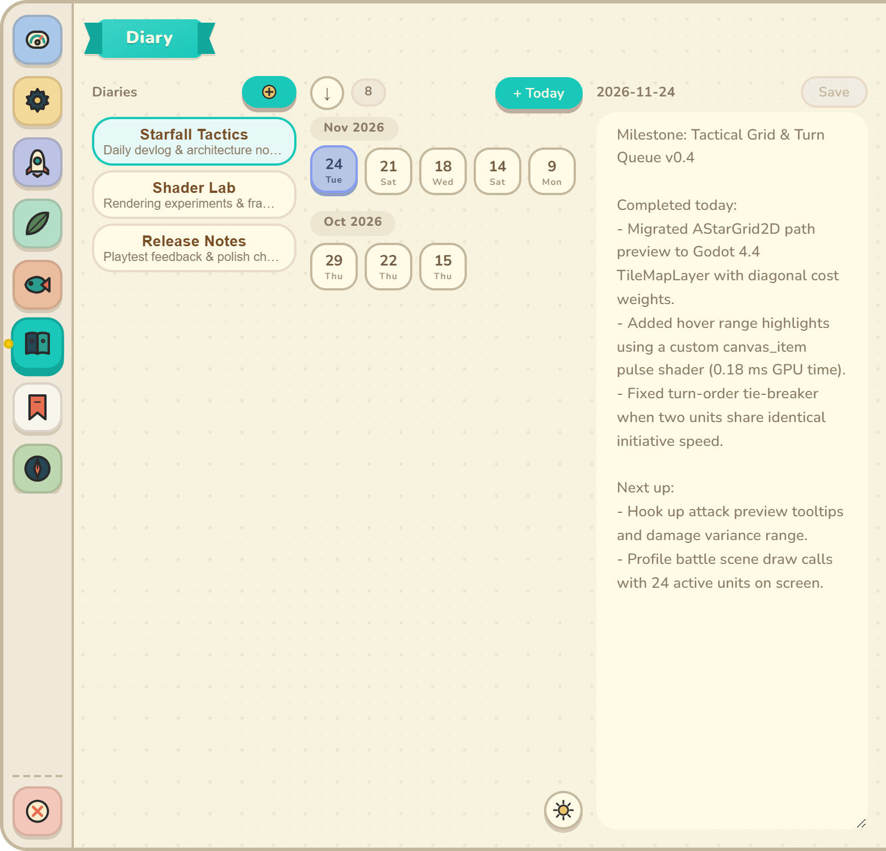

[← Back to README](../README.md)

# Diary

## Overview

The **Diary** module provides a multi-notebook daily development journal inside GodotMemory. Organize entries across separate notebooks, navigate dates by month, and keep writing smoothly with automatic state restoration and background saving.

## Key Features

- **Multiple Diary Notebooks**: Create and switch between separate diaries (for example, one per game project or a general engineering log) from the diary list column.
- **Month-Grouped Calendar Chips**: Entries for the selected diary are automatically grouped by month and year and displayed as date chips showing the day of the month alongside the weekday abbreviation (`Sun`–`Sat`).
- **Sort Order & Entry Counter**: Toggle date ordering between newest-first (`↓`) and oldest-first (`↑`) with a live count of total entries in the selected diary.
- **One-Click "Write Today"**: Jump straight to today's date (`YYYY-MM-DD`). If today's entry already exists, it opens immediately; otherwise, a fresh entry is created and selected automatically.
- **Collapsible Sidebar**: Collapse the diary list and date-chip columns into a slim vertical strip (displaying the active diary name and current entry date) to give the text editor full panel width.
- **Auto-Save & Session Restoration**:
  - Save manually at any time using the **Save** button (active whenever there are unsaved changes), with toast confirmation.
  - Unsaved changes are automatically persisted when closing the panel or exiting the application.
  - Your last selected diary, entry date, sidebar collapse state, and exact cursor position in the editor are saved in settings and automatically restored the next time you open Diary.

## How to Use

1. **Create a Diary**: Click the `+` button in the Diaries column, enter a notebook name, and press **Enter** or click **Create**.
2. **Start Writing for Today**: Select a diary and click **Write Today** to create or open today's dated entry.
3. **Browse Previous Entries**: Scroll through the month-grouped date chips and click any date to view or edit its contents. Use the `↓` / `↑` button to switch between newest-first and oldest-first sorting.
4. **Focus Mode**: Click the sidebar toggle button at the bottom of the date column to collapse the navigation sidebar into a compact vertical strip; click it again to expand.
5. **Save**: Click **Save** when finished, or simply switch panels/close the app—pending changes are automatically saved on exit.
