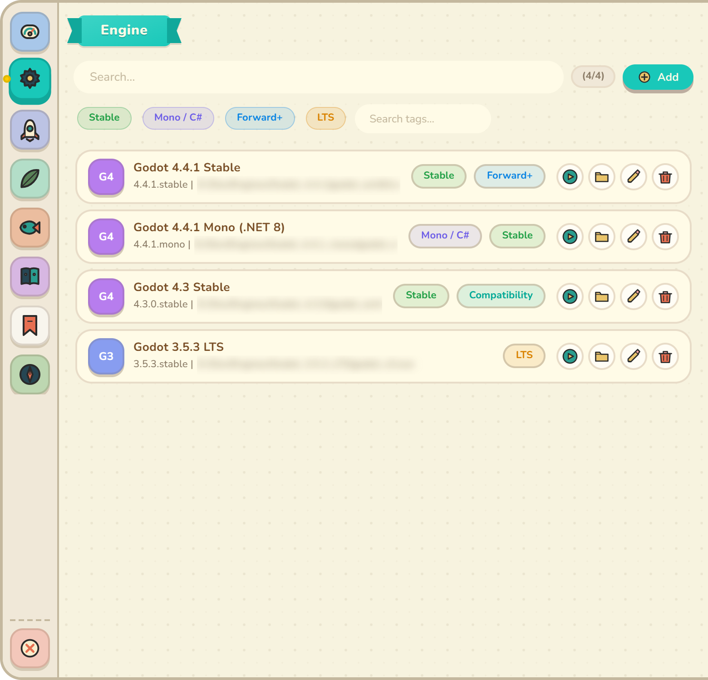

[← Back to README](../README.md)

# Engine Manager

> *Note: Local filesystem paths in screenshots may be blurred for privacy.*

## Overview

The **Engine Manager** keeps all of your local **Godot 3** and **Godot 4** binaries organized in one searchable list. Whether you maintain official stable releases, mono/.NET builds, custom compiled binaries, or encrypted export-template builds, you can register them once, tag them, launch them directly, and link them to your projects in the **Project Manager**.

---

## Key Features

- **Automatic Version & Console Detection**: Entering an executable path automatically runs `<godot> --version` in the background to fill in **Main Version** and **Version**, infers the **Name** from the filename, and populates the companion `.console` executable path.
- **Path Normalization**: Automatically converts Windows backslashes (`\`) to forward slashes (`/`) and strips surrounding quotation marks when pasting copied paths.
- **Custom & Encrypted Build Metadata**: Track whether an engine has a console companion executable, mark a preferred **Default** engine, and store an **Encryption Key** for custom encrypted Godot builds.
- **One-Click Actions**: Launch the engine binary directly, reveal its executable in your OS file manager, edit metadata, or remove the entry from the database.
- **Tagging & Fast-Tag Filtering**: Assign color-coded tags with autocomplete and filter your engine library by keyword and tags.
- **Version Badges**: Engines without a custom image automatically display a color-coded **G3** (Godot 3) or **G4** (Godot 4) badge for quick scanning.

---

## How to Use

### Adding an Engine

1. Open the main panel and switch to the **Engine** tab in the left sidebar.
2. Click **+ Add** in the top-right toolbar.
3. Paste or type the **Executable Path** (for example, `C:/Godot/Godot_v4.3-stable_win64.exe` or `/opt/godot/godot`).
   - If **Name** is empty, GodotMemory automatically fills it from the executable filename.
   - After a brief pause (~0.6s), GodotMemory executes `--version` on the binary to populate **Main Version** (e.g., `4`) and **Version** (e.g., `4.3`).
   - It also auto-fills **Console Executable** (e.g., `C:/Godot/Godot_v4.3-stable_win64.console.exe`) and checks **Has Console**—uncheck it if your build does not include a separate console binary.
4. Optionally configure additional fields:
   - **Default**: Mark this build as your default engine.
   - **Encrypted** + **Encryption Key**: Enable for custom-compiled encrypted Godot builds and store the corresponding key.
   - **Description**: Add notes such as `.NET`, `Forward+`, `Custom modules`, or target platform.
   - **Tags**: Click any fast-tag chip (`+tag`) to attach it, or type in the tag input box to select an existing suggestion or press **Enter** / click **Add** to create a new tag.
5. Click **Save** (enabled once both **Name** and **Executable Path** are filled).

### Launching & Managing Engines

Each engine row displays its icon/version badge, **Name**, `Version | Executable Path`, up to 3 assigned tag chips, and four action buttons on the right:

- **Run** (Play icon): Launches the Godot executable directly.
- **Open Directory** (Folder icon): Opens the containing folder in your OS file manager (and selects the executable on Windows).
- **Edit** (Pencil icon): Opens the edit modal to update paths, version info, flags, description, or tags.
- **Delete** (Trash icon): Removes the engine record from GodotMemory.

### Searching & Filtering

- **Keyword Search**: Type in the top search bar to filter engines (debounced) by **Name**, **Version**, or **Description**. The counter `(shown/total)` updates beside the search input.
- **Fast-Tag Chips**: Click any pinned fast-tag chip below the search bar to toggle it as a filter. You can select multiple tags at once.
- **Tag Search Box**: Type in `Search tags...` to search all engine tags via autocomplete, then click a suggestion or press **Enter** to add it to the active filter.
- **Clear Filters**: Click **x clear** to reset all selected tag filters.
- **Pagination**: Lists display up to **30 items per page**, with page navigation buttons at the bottom when your collection exceeds one page.

---

## Tips & Notes

- **Safe Deletion**: Deleting an engine entry performs a soft delete in GodotMemory's local SQLite database—your actual Godot executable files on disk are **never** deleted.
- **Project Compatibility Matching**: The **Main Version** field (`3` or `4`) controls which engines appear in the **Project Manager**'s engine selector dropdown for a given project. Keep Main Version accurate so your Godot 3 and Godot 4 projects only list compatible builds.
- **Managing Fast Tags & Colors**: Open **Setting → Fast Tags Management** to pin frequently used engine tags (e.g., `4.3`, `Mono`, `Custom`, `Stable`) as quick-filter chips, customize their colors, or delete unused tags.
- **Pasting Quoted Paths**: On Windows, using *"Copy as path"* in File Explorer includes surrounding quotes (`"C:\Godot\godot.exe"`). You can paste it directly into **Executable Path**—GodotMemory strips the quotes and normalizes slashes automatically.
