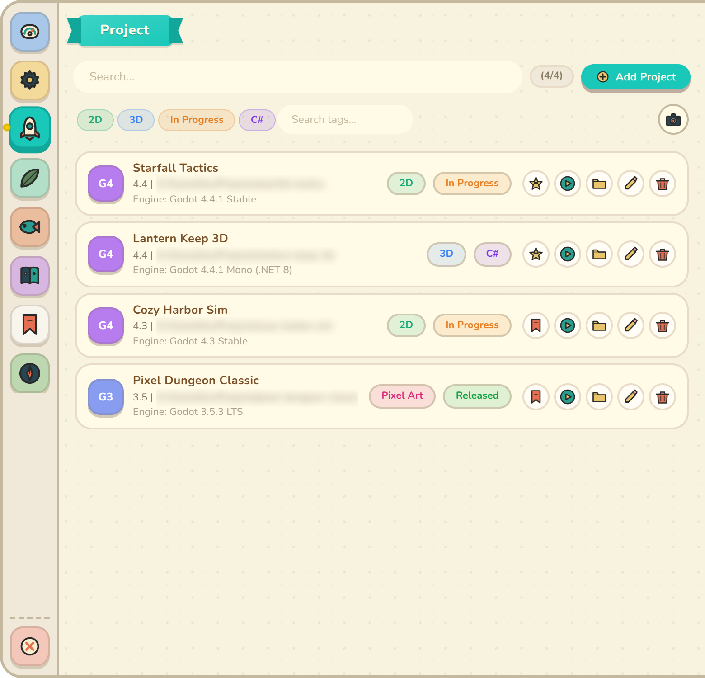

[← Back to README](../README.md)

# Project Manager

> *Note: Local filesystem paths in screenshots may be blurred for privacy.*

## Overview

The **Project Manager** gives you a fast, visual hub for all of your **Godot 3** and **Godot 4** projects. Instead of hunting through folders or juggling incompatible editor versions, you can register each project, automatically parse its `project.godot` metadata and icon, pair it with a specific Godot engine build, attach preview screenshots, star active projects, and launch directly into the Godot Editor with a single click.

---

## Key Features

- **Automatic `project.godot` Scanning**: Entering a project folder path automatically parses `project.godot` to detect the project **Name**, **Main Version**, **Version**, and **Project Icon** (`res://...`), caching the icon locally.
- **Version-Matched Engine Binding**: Associate each project with a registered engine from the **Engine Manager**—the selector automatically filters engines to match the project's major version (`3` vs `4`).
- **One-Click Editor Launch**: Runs `<engine_executable> -e --path <project_directory>` so your project opens straight in the Godot Editor with the exact engine build you assigned.
- **Favorite Pinning (Star)**: Star active projects to keep them pinned to the top of the list.
- **Screenshot Gallery & Hover Zoom**: Attach multiple screenshots to any project and switch the entire list between **Text View** and **Screenshot View** with lazy-loaded thumbnail strips and full-size hover zoom.
- **Keyword & Tag Filtering**: Combine debounced text search with multi-tag filtering and quick fast-tag chips.

---

## How to Use

### Adding a Project

1. Open the main panel and select the **Project** tab (rocket icon) in the left sidebar.
2. Click **+ Add Project** in the top-right toolbar.
3. Paste or enter the **Project Directory** (the folder containing `project.godot`, e.g., `C:/Projects/MyGodotGame` or `/path/to/my-godot-project`).
   - Surrounding quotes are stripped and path separators are normalized automatically.
   - After a brief pause (~0.6s), GodotMemory reads `project.godot` and auto-fills:
     - **Name** (from `config/name`, for new projects)
     - **Main Version** and **Version** (from `config/features` for Godot 4.x or `config_version=4` for Godot 3.x)
     - **Project Icon** (resolving `config/icon`, copying it into the local image cache, and displaying it in the modal header)
4. Select an **Engine** from the dropdown (filtered to engines matching the project's **Main Version**).
5. Optionally add a **Description**, assign **Tags** (click `+tag` fast chips or type in the autocomplete tag box), and attach **Screenshots** via **Add screenshot** (`png`, `jpg`, `jpeg`, `gif`, `bmp`, `webp`).
6. Click **Save** (requires both **Name** and **Project Directory**).

### Launching, Starring & Managing Projects

Each project row provides five quick actions:

- **Star / Unstar** (Star / Bookmark icon): Pins or unpins the project at the top of the list.
- **Run** (Play icon): Launches the project in the Godot Editor using its assigned engine. If no engine is linked yet, a toast notification reminds you (`No engine associated with this project`).
- **Open Directory** (Folder icon): Opens the project folder in your OS file explorer.
- **Edit** (Pencil icon): Updates project metadata, linked engine, tags, or screenshots.
- **Delete** (Trash icon): Soft-deletes the project record from GodotMemory (your project files on disk are not modified).

### Switching Between Text View and Screenshot View

1. Click the **Camera** icon button at the right end of the filter bar (`Show Screenshots` / `Show Text`).
2. **Text View**: Displays project icon (or `G3`/`G4` badge), project name, `Version | Directory`, linked engine name (`Engine: ...`), and up to 3 tags.
3. **Screenshot View**: Replaces the text details with a horizontal strip of cached project screenshots. Hover over any thumbnail to display a floating zoomed preview (automatically scaled up to 85% of the window and positioned to stay on screen).

### Searching & Filtering

- **Search Box**: Filters projects by **Name**, **Version**, and **Description** with a `(shown/total)` counter.
- **Tag Filters**: Click fast-tag chips to toggle filters, or use `Search tags...` with autocomplete to filter by any project tag. Click **x Clear Search** to clear active tag filters.
- **Pagination**: Displays **30 projects per page**, ordered with starred projects first, then newest/highest sort order.

---

## Tips & Notes

- **Register Engines First**: Before binding projects, add your Godot builds in the [Engine Manager](./engine-manager.md) so they appear in the **Engine** dropdown.
- **Cached Icons & Screenshots**: Project icons and attached screenshots are copied into GodotMemory's local cache directory, keeping thumbnails fast and intact even if source screenshot files are moved later.
- **Fast Tags Organization**: Mark frequently used project categories (such as `2D`, `3D`, `Prototype`, `GameJam`, or `In Progress`) as fast tags under **Setting → Fast Tags Management** for one-click filtering and tagging.
- **Safe Deletion**: Deleting a project entry only hides it in the local database; your source code and project directory remain completely untouched.
