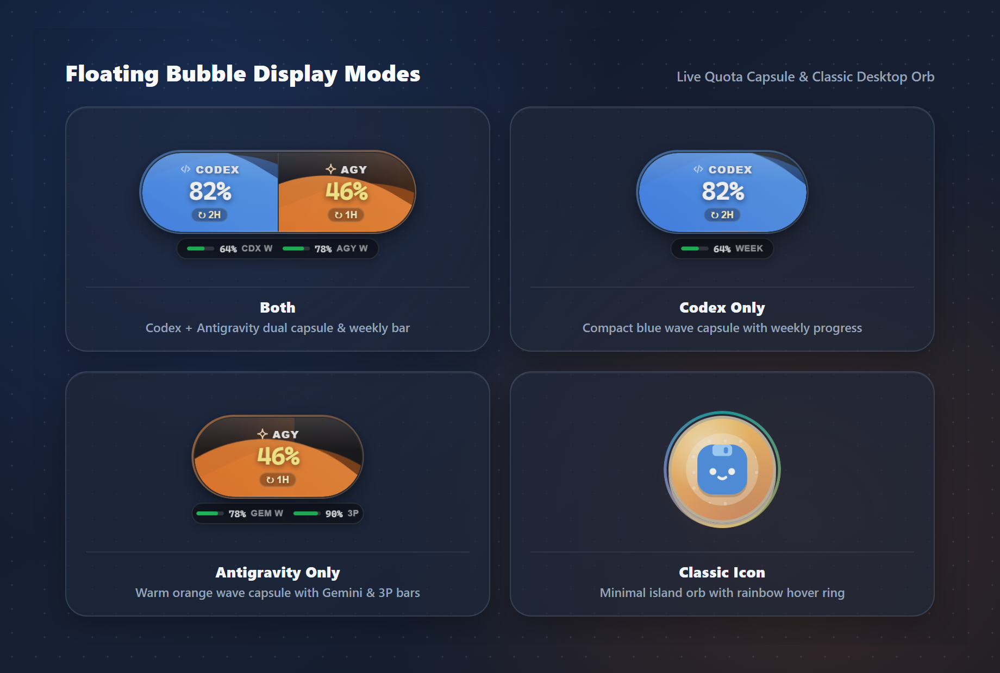
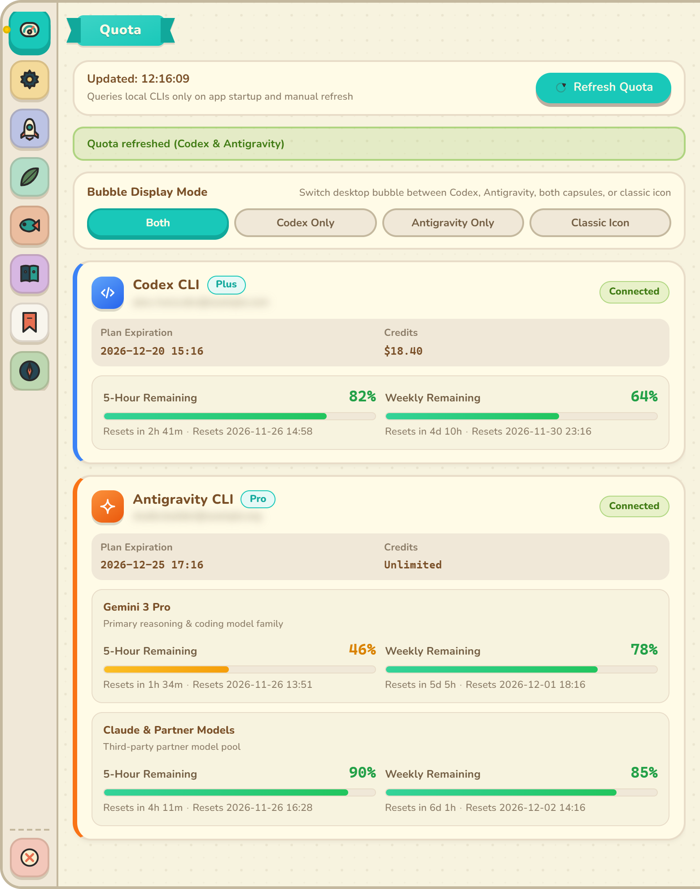

[← Back to README](../README.md)

# Floating Bubble & CLI Plan Quota

> *Note: Sensitive fields in screenshots (such as account email addresses) are blurred for privacy.*

## Overview

GodotMemory lives on your desktop as an always-accessible **floating bubble** that expands into the main workspace when clicked. In addition to acting as a quick launcher for your Godot engines, projects, assets, and notes, the bubble doubles as a live **CLI Plan Quota** monitor for **Codex CLI** (`codex`) and **Antigravity CLI** (`agy`).

Quota data is fetched directly from your local CLI installations using lightweight metadata commands—**consuming zero model tokens**—and runs strictly on **app startup** and **manual refresh**, with **no background polling**.

---

## Key Features

### 1. Four Floating Bubble Display Modes

Switch between four visual layouts at any time from the **Quota** panel or the **Setting** panel:

| Mode | Capsule Layout | Primary Display | Bottom Mini Bar |
| :--- | :--- | :--- | :--- |
| **Both** *(default)* | Dual liquid-tank capsule (`CODEX` blue + `AGY` orange) | 5-hour remaining `%` and short reset countdown (`↻`) for both providers | Weekly remaining for Codex (`CDX W`) and Antigravity (`AGY W`) |
| **Codex Only** | Single blue liquid-tank capsule | Codex 5-hour remaining `%` and short reset countdown | Codex weekly remaining (`WEEK`) |
| **Antigravity Only** | Single orange liquid-tank capsule | Antigravity primary group (Gemini Models) 5-hour remaining `%` and short reset countdown | Gemini weekly remaining (`GEM W`) and secondary model group (`3P`) when available |
| **Classic Icon** | Compact circular icon bubble | App icon only (no quota overlay) | None |

- **Liquid Tank & Status Colors**: The animated water level reflects the remaining quota percentage. Readouts shift color automatically by threshold: **Normal** (`≥ 50%`), **Warning** (`30%–49%`), **Critical** (`1%–29%`), and **Depleted** (`0%`). Reset countdowns also indicate urgency (`≥ 24h` cool, `1h–24h` warm, `< 1h` urgent).
- **Scalable & Translucent**: Adjust **Bubble Size** (`64px`–`160px`, default `110px`) and **Bubble Opacity** (`30%`–`100%`, default `85%`) in **Setting**—both classic and capsule modes scale proportionally.

### 2. Zero-Token Local CLI Querying

When a refresh runs, GodotMemory queries both CLIs in parallel (with an 18-second timeout per CLI and hidden console windows on Windows):

- **Codex CLI (`codex`)**: Spawns `codex app-server --stdio` and sends read-only JSON-RPC calls (`initialize`, `account/read` with `refreshToken: false`, and `account/rateLimits/read`). It also reads subscription expiration metadata from your local `~/.codex/auth.json` ID token if available. No prompts or completions are executed.
- **Antigravity CLI (`agy`)**: Runs `agy -p /usage --output-format json --print-timeout 15s` and `agy -p /credits --output-format json --print-timeout 15s` in parallel. These slash commands query usage and credit balances directly without consuming prompt tokens.

### 3. Startup & Manual Refresh Only (No Background Polling)

- **One-Time Startup Fetch**: GodotMemory automatically runs a single quota check when the app launches.
- **Manual Triggers Only**: After startup, no timers or background polling loops run. Refresh whenever you want via:
  1. The **Refresh Quota** button in the **Quota** panel.
  2. The **Refresh Quota** entry in the system tray right-click menu.

### 4. Clear Refresh Feedback (Success, Partial, Error)

Every refresh emits structured feedback in both the **Quota** panel (status banner + toast) and the untucked floating bubble (a 3.5-second flash badge):

- **Success**: Both Codex and Antigravity connected cleanly. Displays `Quota refreshed (Codex & Antigravity)` in the panel and a brief `Updated` flash on the bubble.
- **Partial (Warning)**: One provider succeeded while the other failed (for example, only one CLI is installed or logged in). Displays a warning notice detailing the failing provider while keeping live data for the connected provider.
- **Error**: Both providers failed or timed out. Displays an error notice with diagnostic details, shows inline error boxes on the affected provider cards, marks the capsule slot with `ERR`, and flashes `Refresh failed` on the bubble.

### 5. Screen-Edge Snapping & Auto-Tucking

- **Free Dragging Across Monitors**: Drag the bubble anywhere on any display; movement respects each monitor's usable work area (excluding taskbars).
- **Magnetic Edge Snap & Auto-Tuck**: Releasing the bubble within the edge snap threshold (default `30px`) of the **Left**, **Right**, **Top**, or **Bottom** screen edge snaps it in place and automatically tucks it into a slim edge strip so it never blocks your IDE or game window.
- **Hover to Reveal**: Move your cursor over the tucked edge strip to slide the full bubble back out; move away to tuck it back in.
- **Smart Panel Expansion**: Clicking the bubble (without dragging) opens the main workspace panel anchored to your docked edge (`750×750` default, resizable down to `500×700`). Collapsing the panel returns smoothly to the bubble and lowers WebView2 memory target while idle on Windows.
- **Remember Position**: Enable **Remember Position** in **Setting** to restore the bubble's last monitor, coordinates, and snapped edge on startup.

---

## How to Use

### Viewing Detailed Plan Quotas

1. Click the floating bubble on your desktop to expand the main panel.
2. Select the **Quota** tab (gauge icon) in the left sidebar.
3. Review the **Codex CLI** and **Antigravity CLI** cards:
   - Header shows the provider name, plan tier badge (e.g., `Plus`, `Pro`, `Team`, `Antigravity`), account email (when provided by the CLI), and connection status pill (`Connected`, `Error`, `Loading`, or `Idle`).
   - Metadata row displays **Plan Expiration** and **Credits** balance (`Unlimited`, remaining credit count, or `--`).
   - Window rows display **5-Hour Remaining**, **Weekly Remaining**, and any extra model-group windows with progress bars, exact countdowns (`Resets in ...`), and local reset timestamps (`Resets YYYY-MM-DD HH:MM`).

### Refreshing Quotas Manually

1. Open the **Quota** panel and click **Refresh Quota** in the top-right toolbar—or right-click the GodotMemory icon in the system tray and choose **Refresh Quota**.
2. Wait for the parallel CLI queries to complete (up to 18 seconds if a CLI is unresponsive).
3. Check the updated timestamp (`Updated: HH:MM:SS`) and notification banner.

### Switching Bubble Display Modes

1. In the **Quota** panel, locate the **Bubble Display Mode** selector card.
2. Click one of the four options: **Both**, **Codex Only**, **Antigravity Only**, or **Classic Icon**.
3. The floating bubble immediately resizes and updates its layout. (You can also change this setting under **Setting → Bubble Display Mode**.)

### Docking and Customizing the Bubble

1. Drag the floating bubble toward any screen edge until it is close to the border, then release to snap and auto-tuck it.
2. Hover over the visible edge strip whenever you want to glance at your quota or click to open the panel.
3. To customize appearance, open **Setting** and adjust:
   - **Bubble Opacity** (`30%`–`100%`)
   - **Bubble Size** (`64px`–`160px`)
   - **Remember Position** (toggle on to persist screen placement across restarts)

---

## Tips & Notes

- **Prerequisites**: Ensure `codex` and/or `agy` are installed, available on your `PATH` (or in their standard Windows `%LOCALAPPDATA%` install locations), and already signed in via terminal before refreshing.
- **Single-Provider Setups**: If you only use one of the two CLIs, switch the bubble mode to **Codex Only** or **Antigravity Only** so the desktop capsule stays compact and focused.
- **Plan Expiration Availability**: Plan expiration is parsed from Codex's local auth token (`~/.codex/auth.json`) when present; CLIs that do not expose subscription end dates display `Not provided by CLI`.
- **Privacy**: All CLI calls run locally on your machine using your existing CLI login; GodotMemory does not transmit quota data to third-party servers.
