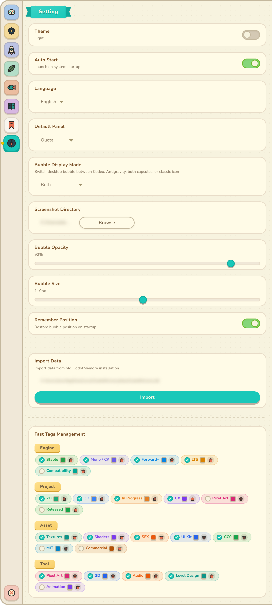

[← Back to README](../README.md)

# Settings

## Overview

The **Settings** module controls global application preferences, floating bubble appearance and behavior, screenshot storage, legacy database migration, and fast-tag organization. All preferences are stored persistently in `settings.json` inside the application data directory.

## Key Features

- **Theme**: Toggle between **Light** and **Dark** interface themes with immediate effect.
- **Auto-Start**: Enable or disable launching GodotMemory automatically at OS login.
- **Language**: Switch the interface language between **English** (`en_US`) and **Chinese** (`zh_CN`), updating both the main panel and detached sticky note windows.
- **Default Panel**: Choose which module opens by default when expanding the main window (`Quota`, `Engine`, `Proj`, `Asset`, `Tool`, `Diary`, `Notes`, or `Setting`; defaults to `Engine`).
- **Floating Bubble Controls**:
  - **Display Mode**: Switch live between **Both** (Codex + Antigravity twin capsules, default), **Codex Only**, **Antigravity Only**, and **Classic Icon**.
  - **Bubble Opacity**: Adjust bubble transparency from `30%` to `100%` (default `85%`).
  - **Bubble Size**: Resize the floating bubble from `64 px` to `160 px` (default `110 px`).
  - **Remember Position**: Persist and restore the floating bubble's last screen coordinates and snapped edge (`Left`, `Right`, `Top`, `Bottom`, or `None`) across application restarts.
- **Screenshot Directory**: Configure a local folder for screenshots by typing a path or choosing one with the native **Browse** directory picker.
- **Legacy Database Import**: Import existing Engines, Projects, Assets, Tools, and Tags from a legacy GodotMemory SQLite database in one click, displaying imported record counts upon success or an error banner if the import fails.
- **Fast Tag Management**: View and manage tags across all four tagged modules (**Engine**, **Proj**, **Asset**, and **Tool**):
  - Toggle the **Quick Tag** checkbox to pin or unpin a tag in that module's quick-filter bar and edit modal.
  - Click a tag's color swatch to assign a custom color via the native color picker.
  - Click the **Trash** icon on any tag chip to delete the tag.

## How to Use

1. **Customize Look & Behavior**: Toggle **Theme** and **Auto-Start**, choose your preferred **Language**, and pick the **Default Panel** you want to see first when opening GodotMemory.
2. **Tune the Floating Bubble**: Pick a **Bubble Display Mode**, drag the **Opacity** and **Size** sliders to fit your desktop, and enable **Remember Position** if you want the bubble to stay where you placed it after restarts.
3. **Set Screenshot Directory**: Click **Browse** next to **Screenshot Directory** (or enter a folder path directly) to configure where screenshots are stored.
4. **Migrate Legacy Data**: If upgrading from an earlier GodotMemory database, click **Import** in the Legacy Database Import section and review the imported counts summary.
5. **Organize Fast Tags**: Scroll to **Fast Tags Management** at the bottom of the panel. Check tags you filter by frequently, click any color square to customize its color, or remove obsolete tags with the trash button.
