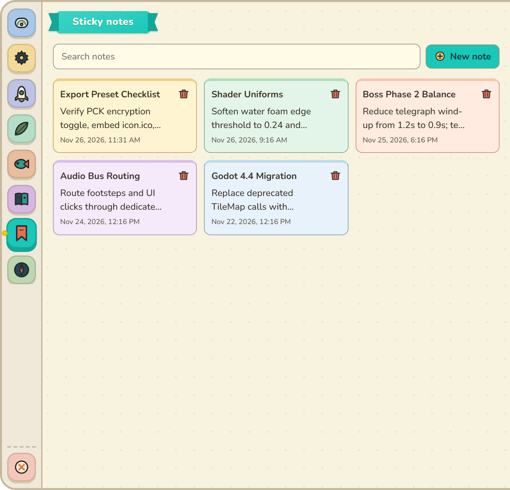

[← Back to README](../README.md)

# Sticky Notes

## Overview

The **Sticky Notes** module lets you create detachable, frameless desktop sticky notes that stay accessible anywhere on your screen while syncing live with the Notes grid inside GodotMemory.

## Key Features

- **Notes Grid & Instant Search**: View all sticky notes as color-coded cards in the main panel. Each card displays a title derived from its first non-empty line, a two-line content preview, and a localized last-updated timestamp. Filter notes in real time with the search input, click a card to open (or focus) its desktop window, or delete notes with confirmation.
- **5 Pastel Color Themes**: Switch any note's paper palette directly from its window header:
  - **Honey** — warm yellow
  - **Mint** — soft green
  - **Peach** — warm coral
  - **Lilac** — light lavender
  - **Sky** — pale blue
- **Detachable Frameless Desktop Windows**:
  - Each note opens in its own independent, resizable, frameless window (`350 × 340` default, `280 × 210` minimum) with a drag grip and compact window controls: color picker, tuck to edge (`⇥`), minimize (`−`), toggle maximize (`□`), and close (`×`).
  - Window bounds (position and size) are persisted per note and restored on the matching monitor on reopen. Newly created notes cascade cleanly on the active monitor.
- **Screen-Edge Snapping & Peek Tabs**:
  - Drag a sticky note within `22 px` of any screen edge (**Left**, **Right**, **Top**, or **Bottom**) or click the **Tuck** (`⇥`) button to snap it to the nearest edge.
  - A tucked note collapses into an always-on-top, taskbar-hidden slim tab along the edge (`12 px` resting depth, sliding out to `34 px` when hovered) showing the note title (vertical on left/right edges, horizontal on top/bottom edges).
  - Hover over a tucked tab to peek at its title, and click the tab to restore the full editable window to its previous size and position.
- **Automatic Saving & Live Sync**: Content and color changes auto-save after a short `180 ms` debounce, whenever the window loses focus, and before tucking, minimizing, or closing. A status footer reports `Saving`, `Saved`, or `Error` (with an inline **Retry** button on failure), and updates immediately synchronize back to the Notes panel.

## How to Use

1. **Create a Note**: Open the **Notes** panel and click **New Note** (`+`). A new note is created and immediately opens as a floating desktop window.
2. **Edit & Style**: Type directly into the note window—the first non-empty line becomes the note's title. Click the circular color swatch in the header to pick from **Honey**, **Mint**, **Peach**, **Lilac**, or **Sky**.
3. **Move, Resize & Tuck**: Drag the note by its top grip bar to reposition it, or resize from its borders. Drag near any monitor edge—or click `⇥` in the header—to tuck the note into an edge tab.
4. **Peek & Restore**: Move your cursor over a tucked edge tab to slide it out and read its title; click the tab to expand the note back into a full window.
5. **Search or Delete**: Use the search bar in the **Notes** panel to filter notes by content. Click the **Trash** icon on a card and confirm to permanently delete a note (and close its window if currently open).
