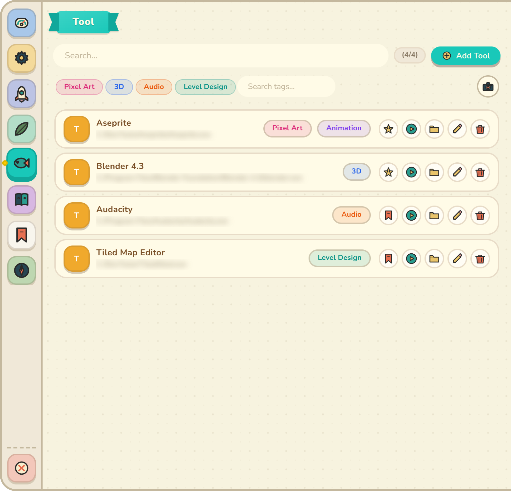

[← Back to README](../README.md)

# Toolbox

## Overview

The **Toolbox** module is a centralized launcher and catalog for the external utilities, scripts, and web resources you use alongside Godot development (such as pixel art editors, audio tools, documentation sites, and build helpers).

## Key Features

- **Automatic Executable Icon Extraction & Name Inference**: Pasting or typing a path to an executable automatically normalizes slashes and surrounding quotes, infers the tool name from the filename if the Name field is empty, and extracts and caches the binary's icon with a live preview.
- **One-Click Launch & Directory Access**: Launch any registered executable directly from the list (`Play`) or open its containing folder in your system file manager (`Folder`).
- **Star / Favorite Pinning**: Toggle stars on frequently used tools to mark and prioritize them.
- **Search & Multi-Tag Filtering**:
  - Instant debounced text search (`300 ms`) with live visible/total counts and pagination (30 items per page).
  - Combine multiple tag filters at once by clicking fast-tag chips in the toolbar or searching all tool tags through the autocomplete tag filter input, with a one-click clear-filter chip.
- **Screenshot Gallery Mode**: Toggle the camera button in the toolbar to switch between the compact text list (icon, name, path, and up to 3 tag chips) and a visual screenshot view showing attached screenshots for each tool.
- **Rich Metadata & Attachments**: Each tool stores a name, executable/directory path, optional reference link, multi-line description, color-coded tags (selectable via fast-tag chips or autocomplete), and multiple attached screenshots.

## How to Use

1. **Add a Tool**: Click **Add Tool** (`+`) in the top toolbar. Enter the executable path—GodotMemory will automatically populate the tool name (if blank) and extract its icon. Optionally add a reference link, description, tags, and screenshots, then click **Save**.
2. **Launch or Open Folder**: Click the **Play** button on a tool row to run the executable, or click the **Folder** button to open its directory.
3. **Filter & Search**: Type into the search bar to filter by text, click fast-tag chips to narrow results by category, or use the tag search box to add additional tag filters. Click **Clear Filter** to reset active tag filters.
4. **Toggle Screenshot View**: Click the **Camera** icon on the right side of the tag bar to switch between text details and screenshot previews.
5. **Edit, Star, or Delete**: Use the inline action buttons on each row to star/unstar, edit metadata, or remove a tool entry.
